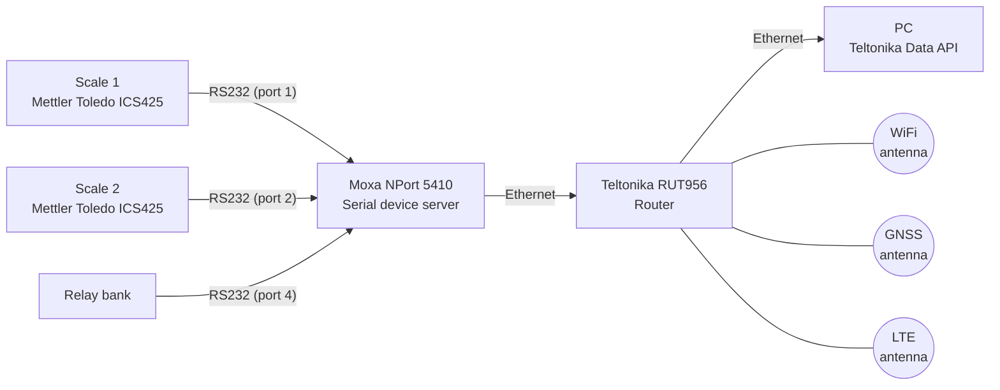

# Traktor veje-system

## Hardware

**Router - Teltonika RUT956:**
<https://www.teltonika-networks.com/products/routers/rut956>

**RS232 serial device server - Moxa NPort 5410:**
<https://www.moxa.com/en/products/industrial-edge-connectivity/serial-device-servers/general-device-servers/nport-5400-series/nport-5410>

**Scales - Mettler Toledo ICS425:**
<https://www.mt.com/dk/da/home/products/Transport_and_Logistics_Solutions/postal_scales_transp_log/basic-postal-scales.html>

## Connections

